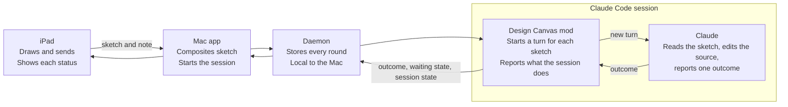

# PRD: Design Canvas Claude Mods

**Status:** Draft v0.3, 2026-10-05, after the spike (v0.2 was earlier the same day; v0.1 was 2026-10-04), for owner review. Phase 1 was implemented on 2026-10-05 on the `claude-mods` branch (X1 to X11, X18 to X26); the daemon and the mod have been run against real Claude Code sessions, the two apps' new screens have not been run on hardware. Phase 2 is not built. Product requirements only; the design and the spike's results are in [technical_doc-ClaudeMods.md](./technical_doc-ClaudeMods.md).
**Owner:** AntheaZ
**Extends:** [PRD-DesignCanvas.md](./PRD-DesignCanvas.md) v0.8 and [PRD-BlankCanvas.md](./PRD-BlankCanvas.md) v0.2. Those documents own the sketch loop on both surfaces. This one owns only how the loop gets into and out of Claude Code. Requirements there are cited by ID and not restated.

Replaces Design Canvas MCP channel with a Claude Code mod, so the user experience becomes more native: a session starts with no special flag, every sketch ends in a clear outcome, and the iPad can later answer Claude directly.

## 1. Problem

A round reaches Claude Code today through an MCP channel process that Claude Code spawns. The channel can push a sketch in and take one reply out, and nothing else. It sits outside the session, so it cannot see what the session is doing, and that produces five problems the designer feels.

| What the designer experiences | Why it happens | Where it is recorded |
|---|---|---|
| Setup needs a development flag and a file written into their repo | Channels are a development feature; the channel is declared in the project's `.mcp.json` | [README](../README.md), Known limits; main PRD section 10, "Marketplace listing" |
| A request sent from iPad looks hung when Claude Code is waiting on a permission prompt | The prompt appears only in the terminal and the channel cannot see it | G19, D20 |
| A round can stay "sent" forever when Claude never read it | If Claude never calls the reply tool, nothing notices | D21 |
| Relaunching the Mac app loses the session; a session started by hand is not recognised | Ownership is tracked in the Mac app's memory | G22 |
| "Needs input" cannot be answered from the iPad | The reply is one structured status per sketch, one way | Main PRD non-goals |

Claude Code mods (v2.1.287 and later) are plugins whose code runs inside the session. A mod can see tool calls, permission decisions and turn boundaries, submit a prompt, and register a tool. That is the vantage point the channel lacks.

## 2. Goals and non-goals

**Goals: adopt Claude Code Mods to support a more native experience**

1. Start session works with a stock Claude Code install (i.e. no development flag, and nothing written into the user's repo MCP setting).
2. Every round ends in an outcome the designer can read on the iPad. None stays "sent" with no explanation. The iPad shows the outcome's status and only the head of Claude's message.
3. Better hand-off experience: the iPad shows when Claude Code is waiting on the person at the Mac.
4. Smooth setup and session continuity: the Mac app recognises a Claude Code session the user started by hand. For a user who has turned Design Canvas on for every session, running Claude Code in a project sets up the whole connection, and opens the Mac app if it is not running. The session survives a relaunch of the Mac app.
5. [Deprioritized, Phase 2] The designer can answer Claude's question from the iPad, and later approve a tool call there.

**Non-goals**

- Nothing changes in how a sketch is drawn or sent. The iPad's drawing flow is untouched.
- Do not involve any pane, command or other interface drawn inside Claude Code. A one-line notice, such as X19's, is not an interface. The mod is plumbing; the designer's surface stays the iPad.
- Agents other than Claude Code, and Claude Code older than v2.1.287, are not in our scope.

**Guardrails**

- Not approving tool calls automatically. The single exception is reading a sketch from Design Canvas's own store (X7).
- No model call made by the mod. The main PRD's rule holds: Claude Code is the agent.
- Nothing is approved from the iPad over an unauthenticated link (X12).
- Loading our mod in every session is optional for users. Start session keeps working with the mod that ships inside the Mac app. Loading the mod in every Claude Code session is an opt-in, asked once at first launch of the Mac app (X20), and needed only to start from Claude Code (X18).

**Success metrics**

These add to the main PRD's section 11; its targets stand.

| Metric | Target |
|---|---|
| Rounds left in "sent" after their turn or session ends | 0 |
| Rounds that receive a reply, on the [reply-compliance eval](./reply-compliance-eval.md) | No lower than the channel's rate |
| Manual steps between install and first round | One first-launch question (X20), then Open project and Start session; no flag, no server path, no repo file |
| Permission prompt appearing to waiting state on the iPad | Under 2 s |
| Sessions lost to a Mac app relaunch | 0 |
| Phase 2: "needs input" rounds answered from the iPad | Trend up |
| Opted-in user runs Claude Code with the Mac app quit, to session connected (X18, X19) | Under 5 s (placeholder, to confirm in the spike) |

## 3. Flow

No longer needed: the channel process that Claude Code spawned, the development flag at launch, and the entry written into the project's `.mcp.json`.

The iPad, the Mac app and the daemon keep their roles; only the last hop changes. The mod claims a stored sketch from the daemon, starts a turn for it, and sends back the outcome along with what the channel could never see: a permission prompt waiting, a turn that ended without a reply, the session ending.

1. The designer taps Done. The Mac app composites the sketch and the daemon stores it, as today.
2. When the session is idle, the mod starts a turn with that sketch. A sketch sent while the session is busy waits its turn and shows as queued on the iPad (X4).
3. If Claude Code stops on a permission prompt, the iPad shows "Waiting at the Mac" (X8).
4. Claude reports one outcome, and the iPad shows it (X5). With no outcome, the mod reminds once, then the round is marked failed (X6).
5. Phase 2 adds the reverse direction: a question or a permission card on the iPad, answered there (X13, X15).

**Two ways in.** Step 2 needs a session with the mod loaded, and Phase 1 offers two ways to get one.

1. From the Mac app, Start session launches Claude Code with the bundled mod, as today but without the flag (X1).
2. From Claude Code, a user who said yes at first launch (X20) runs `claude` in their project; the mod opens the Mac app if it is not running and connects the session to it (X18, X19). Either way the Mac app is a separate app with its own Screen Recording permission, and it keeps running when the session ends.

**More than one session.** With the opt-in on, several Claude Code sessions can be connected at once. Each sketch goes to one of them, the target, whose project name the iPad already shows. The target is chosen by a default, stays put until the user switches it in the Mac menu or on the iPad, and is fixed for a sketch when Done is tapped (X21 to X26).

## 4. Requirements, Phase 1: mod as transport

**Story.** As a designer, I click Start session and sketch. I never see a flag or a config file, and each sketch I send ends as applied, failed or needs input. When Claude is stuck on a prompt at the Mac, the iPad tells me so.

IDs use their own prefix (X) so they cannot collide with D, C, M, P and B. Owner decisions are XG and spike questions are SQ.

| ID | Requirement |
|---|---|
| X1 | Start Claude Code session from our Mac app launches Claude Code with the mod that ships inside the Mac app. No development flag, and no install step for the user. If the mod is already on for every session (X20), Start session does not load it a second time. Amends D3 |
| X2 | Design Canvas writes nothing into the user's project. A `design-canvas` entry left in `.mcp.json` by an earlier version is not touched without the user's say |
| X3 | A sketch starts a new turn in the session, carrying what a round carries today: the sketch, the note, the zoom region, the sending iPad (D10), and whether it is a mirror or a blank round (B8). D4 and D5 are unchanged |
| X4 | One sketch per turn, in the order sent. A sketch sent while another is being worked on waits, and shows as queued on the iPad (M8) until its turn starts. A round marked failed (X6) frees the queue for the next. Resolves G10 |
| X5 | Claude Code reports one outcome per sketch (D6) with the statuses of M8. The iPad shows the status and the head of Claude's message, not the full reply, which can be long. This is a change on the iPad: today it shows the whole message, with no length limit |
| X6 | A round whose turn ends without an outcome is reminded once. If there is still none, or the session ends first, the round is marked failed (M8), with a line saying Claude did not reply. A round whose turn the user stops by hand is marked failed at once, with no reminder, and says it was stopped at the Mac (decided 2026-10-05). No new status. Reverses D21 (decided 2026-10-05) |
| X7 | Claude Code reads a sketch from Design Canvas's store without a permission prompt. Nothing else is approved on the user's behalf. Resolves D22 for the read |
| X8 | While Claude Code is waiting on a permission prompt, the iPad shows "Waiting at the Mac" and nothing else: no tool name and no command (decided 2026-10-05). Display only; the prompt is answered at the Mac. Resolves G19 for visibility |
| X9 | A running session is recognised after the Mac app relaunches, and a session the user started by hand with the mod loaded is usable. D7's three states become two: no session, and a connected session. A Claude Code session without the mod is invisible to Design Canvas. Resolves G22 |
| X10 | If Claude Code is too old for mods, or the user's organisation blocks them, Start session says so in plain words and says what to do. An iPad app older than this feature keeps working and simply does not show the new states |
| X11 | Every delivery, reminder, outcome, waiting state and session change is logged (D8) |
| X18 | A user who has turned Design Canvas on for every Claude Code session (X20) can start from Claude Code: running it in a project connects that session by itself, with no project to pick and no Start session click (added 2026-10-04). Start session (X1) works whether or not that is on |
| X19 | When such a session starts and the Mac app is not running, the mod opens it. The app runs as its own app, with its own Screen Recording permission and menu-bar icon, and keeps running after the session ends. If the app is not installed, the mod says so once, not in every session, and carries on without Design Canvas (XG9) |
| X20 | On first launch the Mac app asks once whether to use Design Canvas in every Claude Code session, and says what yes means: the mod loads in every session in every project, and starting a session opens the Mac app. It is off unless the user says yes. The choice can be changed in Settings, and turning it off removes everything turning it on added (added 2026-10-04) |
| X21 | Every sketch goes to exactly one session, the target. With one session connected, that session is the target and no choice is shown anywhere (added 2026-10-05). Resolves XG3 |
| X22 | With several sessions connected, the default target is the session started with Start session, if there is one, and otherwise the most recently started. Once set, the target is sticky: a newer session never takes over by itself |
| X23 | A sketch is bound to the target at the moment Done is tapped. Switching the target affects the next sketch, never one already sent or queued |
| X24 | The target can be switched in both apps. The Mac menu lists the connected sessions with a tick on the target. On the iPad, tapping the project name in the connection status (P1, P2) lists them. The iPad switcher works over USB and over WiFi (decided 2026-10-05) |
| X25 | Each session in the list shows its project folder name, its Claude Code session title when it has one, its git branch, and the time of its last reply, so two sessions in the same folder can be told apart. A session with no title shows its start time instead (decided 2026-10-05). The spike found that only a session the user named has a title, so the start time is what most rows will show |
| X26 | When the target session ends, its queued sketches are marked failed (X6). If one session remains it becomes the target. If several remain, both apps ask the user to pick, and the iPad does not send a sketch until one is picked |

## 5. Requirements, Phase 2: answer from the iPad

**Deprioritized 2026-10-05.** Phase 2 is kept as written for later. No work is planned on it until Phase 1 has shipped, and XG4 waits with it.

**Story.** As a designer away from the keyboard, when Claude asks me which of two readings of my sketch I meant, I tap the answer on the iPad and the round carries on.

Phase 2 reverses a non-goal of the main PRD ("a conversational two-way channel or permission relay") and delivers its first Future versions item, by a different mechanism than the Channels permission relay named there.

| ID | Requirement |
|---|---|
| X12 | Nothing the iPad sends can approve a tool call unless the link to that iPad is authenticated. A USB connection counts as authenticated (decided 2026-10-05). Over today's WiFi pairing, no approve control is offered. Depends on encrypted pairing (TODO #16) |
| X13 | A question Claude asks during a round appears on the iPad with its options. The designer taps one or types an answer, and Claude receives it as the answer |
| X14 | The Mac and the iPad show the same question. Whichever answers first wins, and the other dismisses |
| X15 | A permission prompt appears on the iPad as an allow-or-deny card naming the tool and showing the exact command or path. There is no "always allow" on the iPad |
| X16 | If the iPad does not answer, disconnects, or anything in the relay fails, the prompt stays at the Mac as today. A failure never results in an approval |
| X17 | Every answer and decision made on the iPad is logged with the device that made it (D8, D10) |

X13 and X14 carry less risk than X15: a spoofed answer misdirects the agent, while a spoofed approval runs a command. Section 7 asks whether questions may ship before encrypted pairing. On a managed machine a mod the user installed cannot approve a call that a deny rule refuses unless the organisation allows it, so X15 never overrides policy.

## 6. Rollout, risks and dependencies

**Rollout**

1. **Spike.** Done 2026-10-05 with a throwaway mod, before any product code. SQ2 passed, so Phase 1 stands as written. Results are in section 7 and in the technical doc, section 10. One check is left over: the literal Screen Recording half of SQ4.
2. **Phase 1, mod by default.** The mod is the only path in the product (decided 2026-10-05). During development the channel is run once more on the reply-compliance eval, as the baseline to beat.
3. **Channel removed.** Once X6's no-reply failure rate and the eval hold up in dogfooding, the channel process, its launch flag and the `.mcp.json` writing are deleted. There is no fallback.
4. **Phase 2.** Deprioritized 2026-10-05; not scheduled.

**Dependencies**

| Dependency | Needed for | State |
|---|---|---|
| Claude Code v2.1.287 or later | Everything | Released; the mods API is new and documented as of v2.1.289 |
| A daemon endpoint the mod can wait on | X3, X4 | To build. A mod cannot read the daemon's event stream |
| One additive message to the iPad | X8 | To build. Additive, so no protocol version bump |
| The server bundled inside the Mac app | X1 | Done on `fix/canvas-ipad-channel-dot` |
| Encrypted WiFi pairing (TODO #16) | X12, X15 | Not started; sized XL |
| A way for the Mac app to register its bundled mod with Claude Code | X18 to X20 | The copy inside the app for now, a marketplace listing once published (XG7). Start session does not need it |
| Daemon endpoints for session state and a session registry | X6, X8, X9, X18 | To build. A throwaway mod reached the running daemon over HTTP on 2026-10-05 |
| Two more additive messages: the session list to the iPad, and the iPad's choice back | X24, X25 | To build. Additive, so no protocol version bump |
| Session title from Claude Code | X25 | Seen in a running session 2026-10-05, on session start and on each prompt, for a session the user named. An unnamed session has none |

**Risks**

| Risk | Effect | Mitigation |
|---|---|---|
| The mods API changes | The mod stops loading after a Claude Code update | Pin a minimum version, and check it at Start session (X10) |
| A mod runs with the user's full permissions and is not sandboxed | A bug in the mod has the reach of the user's account | Keep the mod small, make no model calls, limit X7 to one resolved directory, publish what `claude plugin validate` lists for it |
| A prompt submitted by a mod reads differently to Claude than a channel event | Reply compliance drops | Spike, 2026-10-05: 10 of 10 rounds replied. Measured again with a real iPad at rollout step 2 |
| Organisations block user-installed mods | Design Canvas cannot start a session there | None. Start session says so in plain words (X10); accepted 2026-10-05 |
| The daemon's loopback API has no authentication | Any local process can post a sketch, as today | Unchanged by this PRD; noted so Phase 2 does not widen it |
| After the opt-in, the mod loads in every session, including projects unrelated to Design Canvas | The mod sees every prompt and tool call there, and each session start opens the Mac app | Explicit consent with the consequences stated (X20), off by default, one switch in Settings to undo it |
| The iPad can switch the target over today's unencrypted WiFi | A spoofed iPad, which can already push a sketch, could also aim it at any connected project. Session titles and branch names also cross that link | Accepted 2026-10-05. The target's name is always visible on the Mac menu and the iPad; revisit with TODO #16 |

## 7. Decisions and open questions

**Owner decisions**

- [x] **XG1. D21 is reversed.** Decided 2026-10-05: one reminder, then the round is marked failed. No new status.
- [x] **XG2. The channel is not kept.** Decided 2026-10-05: no fallback. The mod is the one path, and old Claude Code or an organisation that blocks mods gets a clear message (X10).
- [x] **XG3. Which session gets the sketch?** Decided 2026-10-05: one target session, defaulted and sticky, switchable in the Mac menu and on the iPad over USB or WiFi (X21 to X26).
- [ ] **XG4. Questions before pairing?** May X13 and X14 ship over today's WiFi trust, ahead of TODO #16? Over USB, all of Phase 2 is allowed (X12). Deferred with Phase 2.
- [x] **XG5. The old `.mcp.json` entry.** Decided 2026-10-05: leave it be (X2). Found 2026-10-06: left in place, the entry stopped the mod from connecting in that project, because both used the name `design-canvas`. The mod was renamed so the two no longer meet; the entry is still not touched.
- [x] **XG6. What "Waiting at the Mac" shows.** Decided 2026-10-05: only "Waiting at the Mac", with no tool name and no command (X8).
- [x] **XG7. Registration mechanism for the opt-in.** Decided 2026-10-04: the user opts in at first launch (X20), and the Mac app does the registering. Mechanism decided 2026-10-05: a marketplace listing is the target. Until it is published, the opt-in points Claude Code at the copy inside the app. Proposed so that a moved app repairs itself: the app re-registers its current location at each launch.
- [x] **XG8. Does the project picker stay?** With X18 the session names its own project. Decided 2026-10-05: the picker and Recent projects stay, for the Start session button only.
- [x] **XG9. The app is deleted while the opt-in is on.** The mod stays registered and X19's notice would appear in every session, which sits badly with X20's clean undo. Decided 2026-10-05: show the notice once, then stay silent until the app is back.

**Spike questions**

- [x] **SQ1.** Closed 2026-10-05, not a blocker. The current Claude Code docs say channels already work with a Console API key, and the mods docs put no sign-in limit on mods, so the mod path neither fixes nor breaks this. Not tested with a key.
- [x] **SQ2.** A mod's prompt arrives after a sentence naming the mod as sender. Does reply compliance hold against the channel's? Closed 2026-10-05: yes. 10 of 10 synthetic rounds were answered on the first turn, against the eval's bar of 9 of 10. The channel baseline and a run with a real iPad remain for rollout step 2.
- [x] **SQ3.** Can a mod's prompt carry the sketch as an image, or only as a file path as today? Closed 2026-10-05: a file path only, by Claude Code's type declarations. Claude read the path in every spike round, and X7 keeps that read free of a prompt.
- [ ] **SQ4.** Can a mod open the Mac app when a session starts, and does macOS then treat it as the normal signed app for Screen Recording? Half tested 2026-10-05: a throwaway mod opened another Mac app, which ran as its own app and not under Claude Code. Second test 2026-10-05: macOS holds an app the mod opens responsible for itself, exactly as one opened from Finder, so its own grant should apply. Still not run: Design Canvas itself capturing after a mod opened it, because the signed build was in use.
- [x] **SQ5.** Does a running session actually deliver the session title X25 relies on, and for which sessions? Closed 2026-10-05: yes for a session the user named, no for an unnamed one, which falls back to its start time (X25).

## Sources

- Claude Code docs: [Mods overview](https://code.claude.com/docs/en/plugins/mods/overview), [mods API](https://code.claude.com/docs/en/plugins/mods/api), [events](https://code.claude.com/docs/en/plugins/mods/events), [reference](https://code.claude.com/docs/en/plugins/mods/reference), [channels](https://code.claude.com/docs/en/channels)
- In the repo: [PRD-DesignCanvas.md](./PRD-DesignCanvas.md), [PRD-BlankCanvas.md](./PRD-BlankCanvas.md), [TODOS.md](./TODOS.md), the [README](../README.md) (Known limits), [technical_doc.md](./technical_doc.md) for D20 to D22, and [technical_doc-ClaudeMods.md](./technical_doc-ClaudeMods.md) for the design and the spike
- The working copy of this PRD and the per-feature tech details live as Claude docs: [PRD](https://claude.ai/code/artifact/3ccbf545-d893-4ec5-b3bd-ed68ffb60a23), [feature list](https://claude.ai/code/artifact/6723ef24-f05b-4f1f-901c-c01dd0009581)

## Appendix: cited requirements

One line per ID this PRD cites from other documents. Each line is a paraphrase, checked against the source documents on 2026-10-05.

| ID | What it says | Cited by |
|---|---|---|
| B8 | A round is either a mirror round or a blank round | X3 |
| D3 | Start session launches Claude Code (today with the development-channels flag) | X1 amends it |
| D4 | Every sketch and its clean capture are stored locally; nothing leaves the Mac except into the user's Claude Code session | X3 (unchanged) |
| D5 | Each sketch is pushed into Claude Code once, in order, and none is lost if Claude Code is not running | X3 (unchanged) |
| D6 | Claude reports one outcome per sketch | X5 |
| D7 | The Mac app shows the session in one of three states | X9 redefines the states |
| D8 | Deliveries and round events are logged | X11, X17 |
| D10 | Each round records which iPad sent it | X3, X17 |
| D20 | Owner decision: keep the terminal on the mirrored screen, as the mitigation for unseen permission prompts (G19) | Section 1 |
| D21 | A round has no reply timeout | X6 reverses it; XG1 |
| D22 | Two unverified assumptions kept as they are: reading the store path never prompts, and the committed `.mcp.json` entry raises no trust prompt | X7 resolves the first, which the spike found to be false: the read does prompt. X2 retires the second |
| G10 | Whether two sketches delivered in one turn produce correct edits is unmeasured | X4 resolves it |
| G19 | A round looks hung while Claude Code waits on a permission prompt | X8 resolves it for visibility |
| G22 | Relaunching the Mac app loses the session; a session started by hand is not recognised | X9 resolves it |
| M8 | Round statuses shown on the iPad: queued, sent, applied, failed, needs input, with a PR link when present | X4, X5, X6 |
| P1 | Connection status shows both hops and the connected project folder name | X24 |
| P2 | Tapping the status opens details and errors | X24 |
| TODO #16 | Encrypted WiFi pairing | X12, Phase 2, dependencies |
